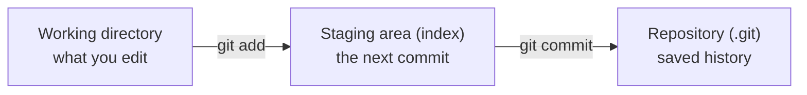
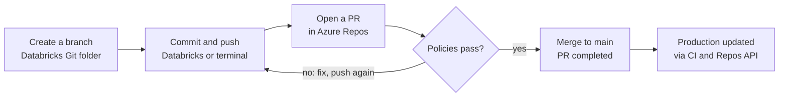

# Git for the Team

How Git thinks, how we use it with Azure DevOps, and how to use it from Databricks

<div class="meta">90 minutes · hrmnjt</div>

<!--
Opening (0:00–0:05). Say what problem Git solves and what people will do
differently tomorrow: every change goes through a branch and a reviewed PR.
-->

---

# Run of show

| Time | Block | Format |
| --- | --- | --- |
| 0:00–0:05 | Opening: why Git, why today | Talk |
| 0:05–0:20 | Part 1 — How Git thinks | Whiteboard + slides |
| 0:20–0:40 | Part 2 — Everyday operations | Live terminal, follow along |
| 0:40–0:55 | Part 3 — Branch, merge, rebase, undo | Demo + conflict exercise |
| 0:55–1:10 | Part 4 — Git with Azure DevOps | Screen share of Azure Repos |
| 1:10–1:22 | Part 5 — Git from Databricks | Screen share of a workspace |
| 1:22–1:30 | Q&A, cheat sheet, homework | Discussion |

<!--
Each layer assumes the one before it. Parts 2 and 3 run long when people
follow along live. Keep Part 1 at 15 minutes even if it feels slow. If short on
time, cut rebase from Part 3 and keep undo.
-->

---
layout: section
---

# Part 1 — How Git thinks

Explain a commit, a branch and HEAD without using the word "magic"

<!--
15 minutes. Teach the model first, commands second — ThePrimeagen's
internals-first approach. People who see commits as a graph stop being scared
of branches and resets.
-->

---

# Git stores snapshots, not diffs

- Each commit is a **full picture** of the project
- …plus a pointer to its **parent** commit(s)
- Same content → same hash → each unique file is stored **once**

<!--
Draw three commits as boxes with arrows pointing back to their parents.
-->

---

# The three areas



<!--
Draw these as three boxes on the whiteboard; add and commit are the arrows
between them. Every command in Part 2 maps onto this picture.
-->

---

# A commit is a small, hashed record

- **snapshot + author + message + parent hash**
- Its ID is a hash of all of that
- Change anything → a **new** commit

> That's why "rewriting history" makes new commits instead of editing old ones.

---

# Branches, HEAD, and remotes

- **A branch is just a label** — a file holding one commit hash. Free to make; deleting one deletes no commits.
- **HEAD = "where you are now"** — usually points at a branch. *Detached HEAD* = pointing straight at a commit.
- **Local vs remote** — your laptop has the full history. `origin/main` is your laptop's *last-known copy* of the server's `main`, not the server itself.

---

# Look under the hood (optional, 3 min)

```bash
git init demo && cd demo
echo "hello" > hello.txt
git add hello.txt && git commit -m "first commit"
ls .git/objects
git cat-file -p HEAD
```

A commit is a small, readable text file.

---

# Check for understanding

### If I delete a branch, are the commits gone?

<v-click>

**No.** They're still there until garbage collection, and `git reflog` can find them.

</v-click>

---
layout: section
---

# Part 2 — Everyday operations

Clone, stage, commit, push, pull, and read `status` and `log`

<!--
20 minutes. Live demo on a throwaway repo in Azure Repos, people typing along.
After every command run git status and git log --oneline --graph --all.
-->

---

# Set up and get the code

| Command | What it does | Demo moment |
| --- | --- | --- |
| `git config --global user.name / user.email` | Sets who you are in every commit | Do it first; wrong email = unlinked commits in Azure DevOps |
| `git clone <url>` | Copies the whole history and sets up `origin` | Clone the demo repo from Azure Repos |
| `git status` | Shows what's in each of the three areas | Run it after every step |
| `git log --oneline --graph --all` | Draws the commit graph | Make it an alias: `git lg` |

---

# Make a commit

| Command | What it does | Demo moment |
| --- | --- | --- |
| `git add <file>` / `git add -p` | Moves changes into the staging area | Show `-p` to stage only part of a file |
| `git commit -m "…"` | Saves the staged snapshot as a new commit | Talk about good messages (what + why) |
| `git diff` / `git diff --staged` | Working vs staged / staged vs last commit | Ties straight back to the three boxes |

---

# Talk to the remote

| Command | What it does | Demo moment |
| --- | --- | --- |
| `git fetch` | Downloads new commits; changes nothing of yours | Show `origin/main` moving ahead of `main` |
| `git pull` | `fetch` + merge (or rebase) into your branch | Explain it's two steps in one |
| `git push` | Uploads your commits and moves the remote branch | First push of a branch needs `-u origin <branch>` |

---

# Housekeeping

| Command | What it does | Demo moment |
| --- | --- | --- |
| `git restore <file>` | Throws away unstaged edits to a file | Warn: this one can't be undone |
| `git stash` / `git stash pop` | Shelves unfinished work so you can switch tasks | "Boss needs a hotfix now" |
| `.gitignore` | Keeps secrets, data and build output out of Git | `.venv/`, `*.pyc`, `.env` |

---

# Exercise (5 min)

1. Everyone adds one line to a shared `attendees.md`
2. Commit, pull, push
3. The second person to push hits:

```text
! [rejected]        main -> main (fetch first)
```

…which sets up Part 3 nicely.

---
layout: section
---

# Part 3 — Branch, merge, rebase, undo

Mistakes are recoverable — stop being afraid to try things

<!--
15 minutes. Draw the graph before and after each command.
-->

---

# Branching and merging (6 min)

- `git switch -c feature/x` makes a branch and moves to it; `git switch main` goes back
- `git merge feature/x`
  - **fast-forward** — just moves the label
  - **merge commit** — a commit with two parents

---

# Conflict exercise

Two people edit the same line in `attendees.md`:

```text
<<<<<<< HEAD
Alex — data platform
=======
Alex — analytics
>>>>>>> feature/x
```

1. Fix the file, delete the markers
2. `git add attendees.md`
3. `git commit`

Same steps again in Azure DevOps and Databricks later.

---

# Rebase (4 min — cut if short on time)

- `git rebase main` replays your commits on top of the latest `main` → a straight line
- **Never rebase commits other people already pulled.** Rebase makes new commits, so a shared branch would need a force push.
- For beginners, **merge is the safe default** — Databricks' own docs say the same.

---
class: dense
---

# Undo cheat sheet

| I want to… | Command | Safe on shared branches? |
| --- | --- | --- |
| Discard edits to a file | `git restore <file>` | Yes (local only) |
| Unstage a file | `git restore --staged <file>` | Yes |
| Fix my last commit's message / add a forgotten file | `git commit --amend` | Only if not pushed yet |
| Undo a commit that's already pushed | `git revert <hash>` | Yes — adds an "undo" commit |
| Move my branch back, keep the changes | `git reset --soft <hash>` | Only if not pushed yet |
| Throw away commits and changes | `git reset --hard <hash>` | Only if not pushed yet |
| Find a commit I "lost" | `git reflog` | Yes — your safety net |

<!--
The slide people will photograph. Later self-study, not this session:
cherry-pick, rebase -i, bisect, worktree (all in ThePrimeagen's course).
-->

---
layout: section
---

# Part 4 — Git with Azure DevOps

Push a branch, open a PR, understand why the policies block you

<!--
15 minutes. Azure Repos is the "remote" from Part 2. Screen-share the real
project, not slides.
-->

---

# Clone and branches (4 min)

1. **Repos → Files → Clone** — the HTTPS URL and "Generate Git credentials"
   - Prefer Git Credential Manager: sign in with Entra ID instead of copying tokens
2. **Repos → Branches** — our naming convention, e.g. `feature/<ticket>-short-name`
   - The server's `main` is the one `origin/main` mirrors

---

# Why you can't push to `main` (4 min)

Branch policies on `main`:

- Require a minimum number of reviewers
- Check for linked work items
- Check for comment resolution
- Limit merge types (for example squash only)
- Build validation (the pipeline must pass)
- Automatically included reviewers (code owners for a path)

<!--
Open the real branch policies and explain each one we use.
-->

---

# Pull request walkthrough (5 min)

Push a branch from the terminal → **Create a pull request**

- Title and description; link the work item
- Reviewers' votes: approve · approve with suggestions · wait for author · reject
- Build validation result and comments
- Merge type on completion
- A new push to the branch **updates the PR**

---

# Conflicts in a PR (2 min)

Conflict banner in Azure DevOps → fix it locally:

```bash
git pull origin main
# resolve the markers
git add . && git commit
git push
```

Same skill as Part 3.

---

# Team conventions

| Decision | Ours |
| --- | --- |
| Branch naming | _TBD_ |
| Merge type into `main` (squash, rebase, merge commit) | _TBD_ |
| Minimum reviewers | _TBD_ |
| Work item required? | _TBD_ |

<!--
Decide these before the session.
-->

---
layout: section
---

# Part 5 — Git from Databricks

The same clone → branch → commit → push loop, through buttons instead of a terminal

<!--
12 minutes. A Databricks Git folder (formerly called Repos) is a Git client
built into the workspace.
-->

---

# Connect once, then create a Git folder (4 min)

- **Same Entra ID tenant** as Azure DevOps → sign-in is automatic
- **Different tenant** → add an Azure DevOps token under *Settings → Linked accounts*
- HTTPS only, not SSH
- **Workspace → your user folder → Create → Git folder** → paste the Azure Repos URL
- Large monorepo → **sparse checkout** so people clone only their part

---

# The Git dialog (5 min)

Open it from the branch name next to the notebook:

1. Create a branch from `main` — never work on `main` in the workspace
2. Edit a notebook, see the diff, write a message, **Commit & Push**
3. **Pull** to get teammates' changes
4. **Merge** or **rebase** from the kebab menu — merge for beginners
5. Resolve a conflict in the editor → **Mark as resolved**
6. **Reset** works like `git reset --hard` — warn people

Then open the PR in **Azure DevOps** — Databricks has no PR screen.

---

# Gotchas

- Each person gets **their own** Git folder; don't share one
- Source-format notebooks never carry outputs; `.ipynb` outputs are committed only if an admin setting allows it — check for data before pushing
- Working branches ≤ **1 GB**; files over **10 MB** can't be viewed in the UI
- One Git operation: ≤ **2 GB** memory, ≤ **4 GB** disk writes
- At most **20,000** workspace assets and files per repo (recommended)
- No GPG-signed commits from Git folders
- Production runs from `main`: jobs point at a Git reference, or CI calls the Repos API after each merge

<!--
If the team also develops locally, mention Databricks Asset Bundles plus
VS Code as the next step — a good topic for the monorepo layer.
-->

---

# Every change reaches main through a reviewed pull request



**Policies pass** = reviewers approve and the build passes. **No** = address comments or fix the build, then push again.

Branching and commits happen in Databricks or the terminal; review, policies and merging happen in Azure DevOps.

---
layout: section
---

# Part 6 — Our monorepo

To fill in later — a 30-minute follow-up

<!--
Questions to answer, each with one real example from the repo: layout and
code owners; branch naming and merge type; what PR build validation runs and
how to run it locally; Databricks Git folder setup with sparse checkout paths
per team; how changes reach dev, test and prod; .gitignore rules and what must
never be committed; a "first PR" task for week one.
-->

---

# Before you leave

**Homework:** open one real PR in Azure DevOps from a Databricks Git folder, and one from the terminal.

**When you're stuck:**

- [Oh Shit, Git!?!](https://ohshitgit.com/) — recovery recipes
- [Learn Git Branching](https://learngitbranching.js.org/) — practise in the browser
- [Pro Git](https://git-scm.com/book/en/v2), chapters 1–3
- [Everything You'll Need to Know About Git — ThePrimeagen](https://frontendmasters.com/courses/everything-git/) — the deep dive (about 3.5 hours)

The cheat sheet and full source list are in `outline.md`.

<!--
Set up a channel or office hour for Git questions in the first two weeks.
-->
